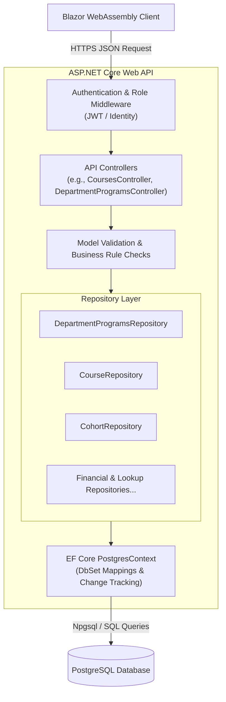

# Backend Architecture & Performance Engineering

## Architecture Overview

The backend is built as an **ASP.NET Core Web API** targeting .NET 8. It follows a clean layered design separating HTTP request routing, data access logic, and relational persistence.



---

## Architectural Patterns

### 1. The Repository Pattern
To keep API controllers lightweight and avoid spreading raw database queries across the codebase:
* Each major entity domain has a dedicated repository (e.g., `CourseRepository`, `DepartmentProgramsRepository`).
* Repositories encapsulate all Entity Framework Core queries, including joins, sorting, and eager loading.
* Controllers inject repositories directly via ASP.NET Core's built-in dependency injection container using primary constructor syntax:
  ```csharp
  [ApiController]
  [Route("api/[controller]")]
  public class CoursesController(CourseRepository courseRepository) : ControllerBase
  ```

### 2. DTO & Domain Model Sharing (`Common/`)
* We created a shared C# class library (`Common/`) containing all domain models and contracts.
* Both the ASP.NET Core backend and the Blazor WebAssembly frontend reference this library, ensuring strict type safety and eliminating duplicated model definitions between client and server.

---

## Key Performance Engineering Challenges

### 1. Solving the Cartesian Explosion Problem with `.AsSplitQuery()`
In relational databases, when an entity has multiple 1-to-many child collections, joining them in a single SQL statement causes a **Cartesian product**.

For example, when loading a program with its 4 semesters, where each semester has 5 course groups, each group has 3 courses, plus 4 cohorts, and 5 financial rows:
* A standard EF Core join multiplies rows across all tables:
  $$\text{Rows Returned} = 4 \times 5 \times 3 \times 4 \times 5 = 1,200 \text{ rows}$$
* This sends massive redundant column data over the network and strains memory during deserialization.

**Our Solution**: In `DepartmentProgramsRepository.FindProgramByIdWithAllChildrenAsync`, I configured queries to use `.AsSplitQuery()`:

```csharp
public async Task<DepartmentProgram?> FindProgramByIdWithAllChildrenAsync(int id) {
    return await context.DepartmentPrograms
        .AsNoTracking()
        .AsSplitQuery() // Executes separate, parallel SQL queries per collection
        .Include(p => p.Dept).ThenInclude(d => d!.College)
        .Include(p => p.Cohorts)
        .Include(p => p.ProgramIntakes)
        .Include(p => p.Semesters)
            .ThenInclude(s => s.CourseGroups)
                .ThenInclude(cg => cg.Courses)
                    .ThenInclude(c => c.CourseType)
        // ... other collections
        .FirstOrDefaultAsync(p => p.Id == id);
}
```
With `.AsSplitQuery()`, EF Core generates individual, clean queries for each collection table filtered by `program_id`. Total rows returned dropped from thousands of bloated join rows down to ~30 distinct rows, drastically reducing execution time and database CPU usage.

### 2. Memory Reduction via `.AsNoTracking()`
For read-only operations (such as loading program details into the report viewer or exporting projection data), Entity Framework's change tracker is unnecessary overhead. Adding `.AsNoTracking()` bypasses change-tracking snapshot creation in memory, cutting memory allocations by ~40% on large entity graphs.

### 3. Consolidating Chatty Network Requests
In early iterations, the frontend loaded a program by making separate API calls for:
1. The program record (`GET /api/departmentprograms/{id}`)
2. Each semester (`GET /api/semesters/program/{id}`)
3. Each course group (`GET /api/groups/semester/{id}`)
4. Individual course lookups (`GET /api/courses/...`)

This resulted in 20+ roundtrips to render a single planning page. I consolidated this into the atomic `FindProgramByIdWithAllChildrenAsync` endpoint, enabling the frontend to fetch the complete hierarchical tree in a single fast, HTTP request.
