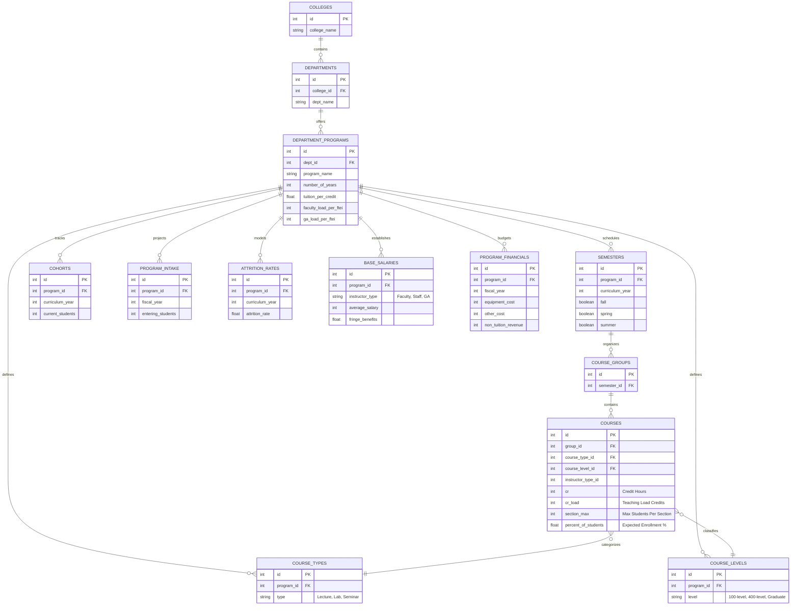

# Database Design & Schema Architecture

## Overview

The database is built on **PostgreSQL** and managed using **Entity Framework Core**. 

The schema mirrors a university's real-world operational structure, divided into four functional domains:
1. **Organizational Hierarchy**: Colleges, departments, and degree programs.
2. **Curriculum Delivery**: Semesters, course groups, courses, and customizable type/level lookups.
3. **Student Projections**: Cohort headcounts, entering intake per fiscal year, and curriculum attrition rates.
4. **Faculty Staffing & Financials**: Salary baselines by instructor type, non-instructional faculty loads, and departmental overhead.

---

## Entity-Relationship Diagram

---

## Relational Design Decisions

### 1. Curriculum Hierarchy (`DepartmentProgram` → `Semester` → `CourseGroup` → `Course`)
* A degree program is structured into multi-year curriculum cycles (typically 1 to 4 years).
* Each curriculum year can offer courses in **Fall, Spring, and Summer** terms (`semesters`).
* Within a semester, courses are clustered into `course_groups` to represent alternative course tracks or co-requisite clusters.
* Each `course` stores its credit hours (`cr`), faculty workload weight (`cr_load`), maximum capacity per section (`section_max`), and the percentage of students in that cohort expected to enroll (`percent_of_students`).

### 2. Program-Scoped Lookup Tables with Default Templates
* Rather than enforcing rigid, campus-wide course classifications, different departments require different course types (e.g., Nursing needs *"Clinical Rotation"*, while Art needs *"Studio Practice"*).
* We designed `course_types` and `course_levels` to link directly to `program_id`. 
* When a user creates a new program, the system automatically clones rows from `default_course_types` and `default_course_levels` into program-scoped lookup tables, giving each department full flexibility to customize course labels without altering global university defaults.

### 3. Referential Integrity & Cascades
* Deleting a degree program should clean up its underlying curriculum schedule and projection tables without leaving orphan records.
* Foreign keys linking `semesters`, `cohorts`, `base_salaries`, and `program_financials` back to `department_programs` are configured with `ON DELETE CASCADE`.
* Conversely, `colleges` and `departments` use restrictive deletion so administrative units cannot be deleted accidentally if active programs belong to them.
