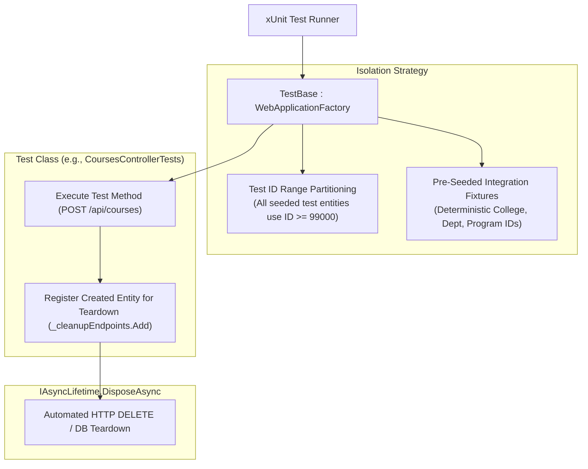

# Showcase: Integration Testing & Test Isolation

## Why In-Memory Database Mocks Weren't Enough

Many .NET tutorials suggest using EF Core's `UseInMemoryDatabase()` for unit and integration testing. Early on, our team discovered this caused major false positives:
* The in-memory provider does not enforce relational constraints, foreign keys, or unique indexes.
* It does not test real SQL generation (such as how PostgreSQL handles `.AsSplitQuery()` or cascade deletes).
* Queries that succeeded in in-memory tests would fail in production when executed against PostgreSQL.

To ensure our test suite actually caught bugs, I built an integration testing foundation that spins up the real ASP.NET Core application pipeline against a real PostgreSQL instance using `WebApplicationFactory<Program>`.

---

## Test Architecture & Isolation Strategy

Running integration tests against a shared database introduces the risk of tests polluting each other's data or colliding during parallel test runs. I solved this with three patterns:

### 1. Test ID Namespace Partitioning (`>= 99000`)
All pre-seeded test fixtures (test colleges, departments, degree programs, and salary bands) are assigned explicit integer IDs starting at `99000`. 
* Development and production records never use IDs in this range.
* Tests can query well-known IDs (e.g., `TestProgramIds.ComputerScienceBS = 99001`) with guaranteed consistency.

### 2. Automated Lifecycle Teardown with `IAsyncLifetime`
Tests that create new entities record their endpoints in a `_cleanupEndpoints` list. When xUnit finishes executing the test, `DisposeAsync()` automatically deletes newly created resources, leaving the test database in a clean state.

---

## Included Files
* [`TestBase.cs`](TestBase.cs): The base integration test fixture extending `WebApplicationFactory<Program>` and exposing typed HTTP clients with test ID constants.
* [`CoursesControllerTests.cs`](CoursesControllerTests.cs): Complete integration test suite verifying HTTP response codes, query filtering, authorization, and CRUD persistence.
